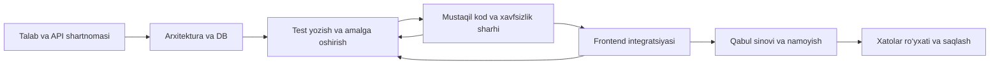

# SDLC

Har bosqich mahsuloti: talablar ro‘yxati; REST/ER shartnomasi; kod va avtomatik test; sharh qaydlari; ishlaydigan to‘liq oqim; haqiqiy natijalar hisoboti. Test avval xatti-harakat yo‘qligi sabab muvaffaqiyatsiz bo‘lishi, so‘ng minimal yechim bilan o‘tishi kerak.

Frontend faol ishlab chiqilayotganda uning fayllari Gemini tasarrufida. Integratsion tahrir faqat handoffdan va bir vaqtdagi tahrirlar tugagandan keyin. Migratsiya mavjud bazani avtomatik qayta yaratmaydi.
