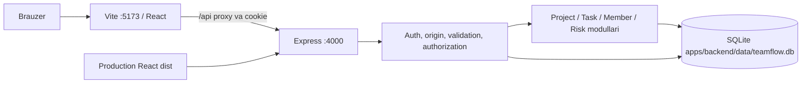
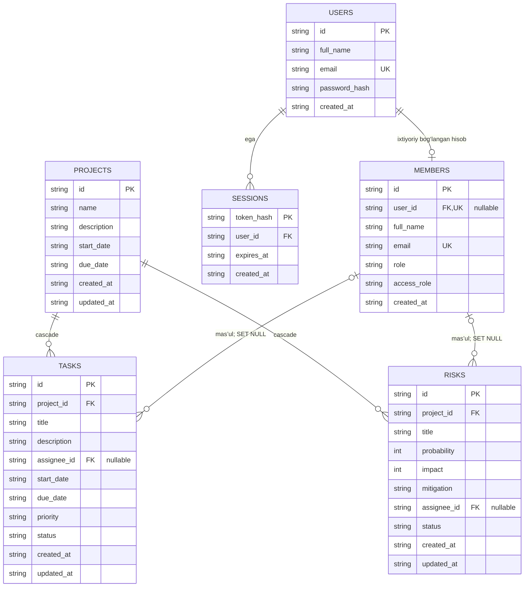

# Arxitektura

Modulli monolit: React interfeysi REST orqali bitta Express jarayoniga murojaat qiladi; faqat server SQLitega kira oladi. Bitta umumiy jamoa mavjud. Node.js 22.13+ talab qilinadi; tekshirilgan lokal runtime versiyasi yakuniy hisobotda beriladi.

Developmentda Vite `/api`ni 4000 portiga uzatadi. Productionda backend build qilingan `apps/frontend/dist`ni berishi mumkin. Kalendarga alohida jadval kerak emas: vazifa sanalari ishlatiladi. Dashboard va jamoa statistikasi ham vazifalardan olinadi.

2026-11-17 joriy terminal handoffidan keyingi integratsiyada frontend xizmatlari faqat shu APIga ulanadigan qilingan; MockContext, mockAdapter va mockData olib tashlangan. Loading/xato qayta urinishlari, sessiya bekor bo‘lishi, logout xatolari va pending logout holatlari ko‘rsatiladi. Taqvim Asia/Tashkent oyiga, dashboard vaqt yo‘lagi vazifalarning haqiqiy sanalariga tayanadi. Modal nomi va klaviatura fokusi hamda Back navigatsiyasidagi filtr holati regressiya ssenariylari bilan tekshiriladi. Yakuniy suite natijasi root hisobotda.

Development Vite fayl xizmatida ignored credential fayllariga kirish cheklangan; xavfsizlik testi real parol o‘rniga sintetik qiymat ishlatadi. Generated demo credentiallar faqat ignored `apps/backend/data/demo-credentials.json`da; custom `name.db` uchun qo‘shni `name.demo-credentials.json`. Brauzer avtomatlashtirish Playwrightning alohida headless Microsoft Edge sessiyasida bajariladi. Connected Chrome pluginidagi buyruq xatosi sabab uning foydalanuvchi Chrome sessiyasi orqali UI tekshiruvi o‘tgan deb da’vo qilinmaydi.

IDlar UUID. Foreign key har bir ulanishda yoqiladi. Loyiha o‘chirilganda vazifa va risklar cascade qilinadi; oddiy a’zo o‘chirilganda mas’ullik bo‘shaydi va bog‘langan hisob sessiyalari bekor qilinadi. Hisob qolsa ham a’zolik yo‘qligi sabab pending bo‘ladi. Birlamchi manager himoyalangan.

Sessiya tokeni kriptografik tasodifiy; bazaga faqat hash yoziladi. `teamflow_session` HttpOnly, SameSite=Lax, Path=/ cookie orqali yuboriladi; HTTPS productionda Secure qo‘llanadi. Har himoyalangan so‘rov DBdagi hisob va joriy a’zolikdan ruxsatni oladi. Origin va content type nazorati, login rate limit, qat’iy DTO validatsiya va parametrli SQL qo‘llanadi. Ko‘p bosqichli mutatsiyalar transaction ichida bajariladi.

Joriy DB boshlang‘ich sozlash kodi `CREATE TABLE IF NOT EXISTS` va `CREATE INDEX IF NOT EXISTS` ishlatadi; uni qayta chaqirish mavjud yozuvlarni reset qilmaydi. Versiya reyestri va oldingi sxemalardan avtomatik upgrade migratsiyalari hozir implementatsiya qilinmagan. Kelajakdagi sxema o‘zgarishi uchun alohida ma’lumotni saqlovchi migratsiya va moslik testi kerak. Demo seed ixtiyoriy; production bazasini avtomatik reset qilish taqiqlangan. `DATABASE_PATH` terminal joyidan qat’i nazar backend katalogiga nisbatan yechiladi.
